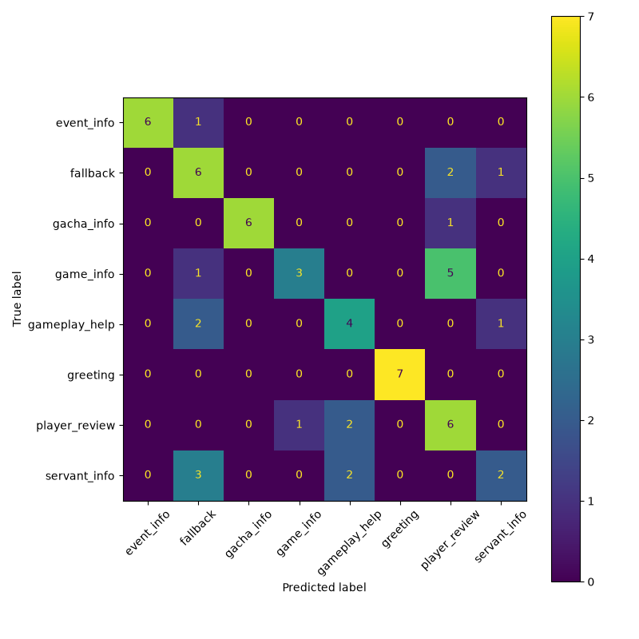

FGO Chatbot

An AI-powered chatbot for Fate/Grand Order (FGO) with a 3D avatar. It understands questions
written in natural language and answers within one domain: the game, its gacha, combat,
events, player opinions, and individual servants.

The language understanding is a trained machine-learning model (TF-IDF features + Logistic
Regression), not hand-written if/else rules. A separate step recognizes servant names and looks
their details up in the free Atlas Academy game-data API.


How it works

```
user message -> preprocessing -> TF-IDF -> Logistic Regression (intent + confidence)
                      \-> servant-name recognition (NER) ----------+
                                                                    v
                                               response routing (4 rules, cutoff 0.20)
                                                                    v
                          JSON { reply, intent, confidence, kind } -> chat page + 3D avatar
```


Folder layout

```
FgoChatbot/
  README.md, SETUP.txt, LICENSE, .gitignore
  docs/                          pipeline diagram, error analysis, build log, demo plan, usability sheet
  chatbot_backend/               Python: the chatbot's "brain"
    app.py                       Flask server  (POST /chat)
    train_model.py               trains + evaluates the model, writes model_results.txt
    fgo_dataset.csv              310 labelled example questions, 8 intents
    chatbot_model.pkl, vectorizer.pkl   the trained model (recreate with train_model.py)
    servant_data.py              servant roster (Atlas Academy API), name matching
    tamamo_voice.py              servant and class answer wording
    responses_data.py            reply bank (varied replies per intent)
    test_responses.py            42-question end-to-end check -> test_results.txt
    measure_performance.py       reply-time measurement -> performance_results.txt
    inspect_vrm.py               optional: reads a .vrm file's expressions/license
    requirements.txt             Python packages
  chatbot_frontend/chatbot_frontend/   JavaScript: the chat page + avatar (the folder with package.json)
    index.html, main.js, avatar.js
    public/models/               put avatar.vrm here (not included, see below)
```

Get the code

```bash
git clone https://github.com/YOUR-USERNAME/fgo-chatbot.git
cd fgo-chatbot
```

Run it

You need two terminals open at the same time.

1. Backend (Python 3.12 or newer; developed on 3.13):
```powershell
cd chatbot_backend
python -m venv ..\.venv                 # first time only
..\.venv\Scripts\Activate.ps1
pip install -r requirements.txt         # first time only
python app.py                           # leave running; serves on http://127.0.0.1:5000
# macOS/Linux: activate with  source ../.venv/bin/activate
```
The first start downloads the servant list (about 400 servants) and saves it as
`servant_cache.json`. Keep that file: with it the bot works without an internet connection.

2. Frontend (Node.js):
```powershell
cd chatbot_frontend\chatbot_frontend
npm install                             # first time only
npm run dev                             # then open http://localhost:5173
```

Not included in this repository

- The 3D avatar model.** It is a third-party character model with its own license, so it is
  not redistributed here. Without it the chat works normally and the page reports that the avatar
  could not load. To see the avatar, put any VRM file at
  `chatbot_frontend/chatbot_frontend/public/models/avatar.vrm` and credit its author in `index.html`.
- **The servant list (`servant_cache.json`).** It is downloaded from the Atlas Academy API the
  first time the server starts (internet needed once) and saved next to `app.py`.

Retrain, test, measure

```powershell
python train_model.py            # retrains; writes model_results.txt, confusion_matrix.png, .pkl files
python test_responses.py         # needs app.py running; writes test_results.txt
python measure_performance.py    # needs app.py running; writes performance_results.txt
```
After retraining, restart `app.py` so it loads the new model.

Results (final model)

| Measure | Result |
| Accuracy on the held-out split (62 questions) | 0.65 (macro F1 0.66) |
| 5-fold cross-validation, repeated 3 times | accuracy 0.663 +/- 0.058, macro F1 0.666 +/- 0.057 |
| End-to-end hand-written test (42 questions) | 37/42 (88%); 31/35 (88%) on questions not in the training data |
| Reply time (author's PC: Windows 11, Python 3.13; 60 requests) | mean 15.5 ms, 95th percentile 29.5 ms, about 64 replies per second; first request 22 ms (it was 1,200 ms before the startup warm-up fix) |

Full per-intent precision/recall/F1 and the confusion matrix are in
`chatbot_backend/model_results.txt` and `chatbot_backend/confusion_matrix.png`:



Servant names, nicknames and classes

The bot finds servants by name even with accents, hyphens, last names, small typos, or filler
words ("tell me about raikou"). It also answers questions about a whole class ("saber",
"what are the servant classes"), using the matchups plus counts and examples from the servant data.

The English game sometimes spells names differently from wikis and fans (for example "Altria"
in the game, "Artoria" everywhere else). To see how a name is spelled in the loaded data:
```powershell
python -c "import json; [print(s['collectionNo'], s['name']) for s in json.load(open('servant_cache.json', encoding='utf-8')) if 'pendragon' in s['name'].lower()]"
```
(change `pendragon` to any part of a name). To add a nickname, add a line to `ALIAS_OVERRIDES`
(one word -> the full name) or `PHRASE_ALIASES` (several words -> the full name) at the top of
`servant_data.py`, using the name exactly as printed above, in lowercase, with hyphens and
brackets written as spaces. A line whose target name is not in the data simply does nothing.

Known limitations

- Small dataset. 310 hand-written questions (35-45 per intent). Accuracy is about 66%, and
  intents that share vocabulary (game info vs. player opinions) get confused. More data per
  intent is the main way to improve it.
- Hand-written data. The questions were written by the project author, not collected from
  real users, so real-world accuracy may be lower than the numbers above.
- **Not covered:** craft essences and materials. Questions about them are not answered correctly.
- **Gacha and event answers are general.** Game rules change, so the replies avoid specifics
  such as the current banner or event schedule.
- Servant details (class, rarity, alignment, traits, stats) come from the Atlas Academy data
  and are only as current as the cached `servant_cache.json`.

Credits and notices

- Servant data: Atlas Academy game-data API (https://api.atlasacademy.io).
- 3D avatar model: 猫又おかゆ (author per the file's metadata: hololive), used under the model's
  own license, which requires credit.
- *Fate/Grand Order* and its characters belong to their respective owners. This is an
  unofficial, non-commercial student project. The chatbot's playful voice is original wording
  inspired by a character's personality; no game dialogue is copied.
- Libraries: scikit-learn, NLTK, Flask, Three.js, @pixiv/three-vrm.
